# NeonWave · musicVer

A desktop music player built with **Python**, **pywebview**, **VLC** and a
self-contained SPA called **musicVer**. The new interface lives in `f-3/` and is
the default when you run `python main.py`. The older `frontend/` and
`frontend_v2/` interfaces are preserved and can still be launched with an
environment variable.

musicVer combines JioSaavn streaming, a local music library, playlists, saved
albums, artist/album discovery, a glass player and a persistent light/dark
theme in one small desktop app.

---

## Contents

- [Screenshots](#screenshots)
- [Quick start](#quick-start)
- [Launch options](#launch-options)
- [Features](#features)
  - [Dynamic island navigation](#dynamic-island-navigation)
  - [Home](#home)
  - [Discover and search](#discover-and-search)
  - [Artist pages](#artist-pages)
  - [Album overview](#album-overview)
  - [Library and playlists](#library-and-playlists)
  - [Account and profile picture](#account-and-profile-picture)
  - [Player, queue and Flow State](#player-queue-and-flow-state)
  - [Likes and saved albums](#likes-and-saved-albums)
  - [Dark mode and motion](#dark-mode-and-motion)
  - [Audio sources](#audio-sources)
- [How it is wired](#how-it-is-wired)
- [Project layout](#project-layout)
- [Data and privacy notes](#data-and-privacy-notes)
- [Troubleshooting](#troubleshooting)

---

## Screenshots

All screenshots below were captured from the browser preview of `f-3/`, so they
contain only the bundled demo catalogue and no personal library data.

<table>
  <tr>
    <td align="center"><a href="docs/screenshots/01-home.webp">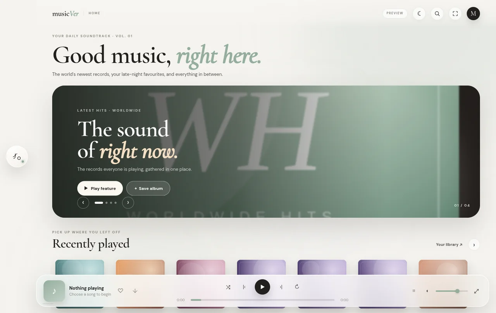</a><br><b>Home</b></td>
    <td align="center"><a href="docs/screenshots/02-home-shelves.webp">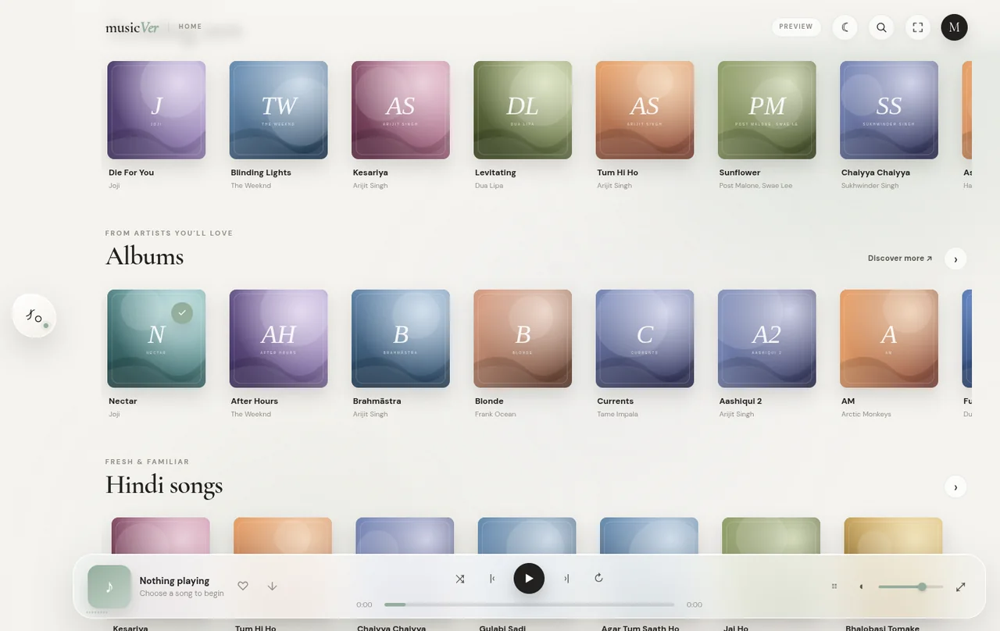</a><br><b>Horizontal shelves</b></td>
    <td align="center"><a href="docs/screenshots/03-discover.webp">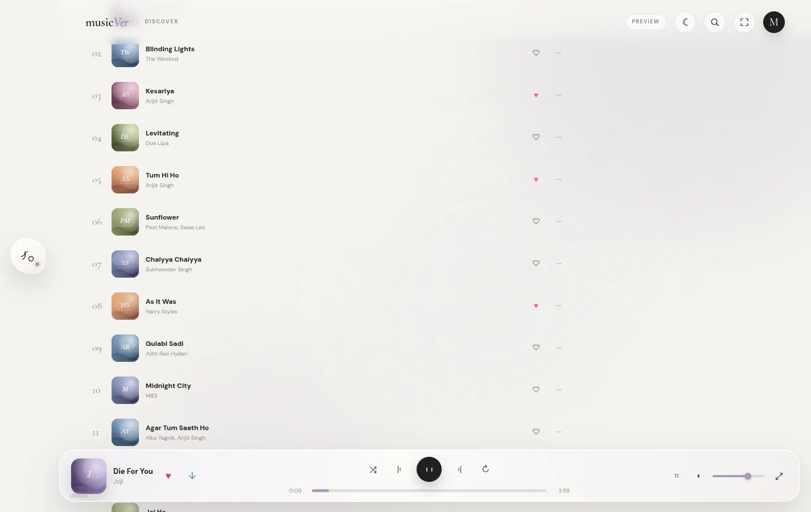</a><br><b>Discover</b></td>
  </tr>
  <tr>
    <td align="center"><a href="docs/screenshots/04-artist.webp">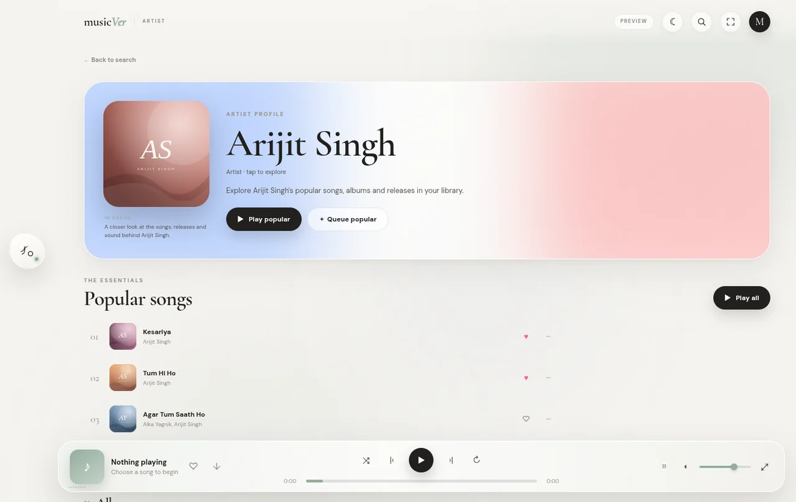</a><br><b>Artist profile</b></td>
    <td align="center"><a href="docs/screenshots/05-album.webp">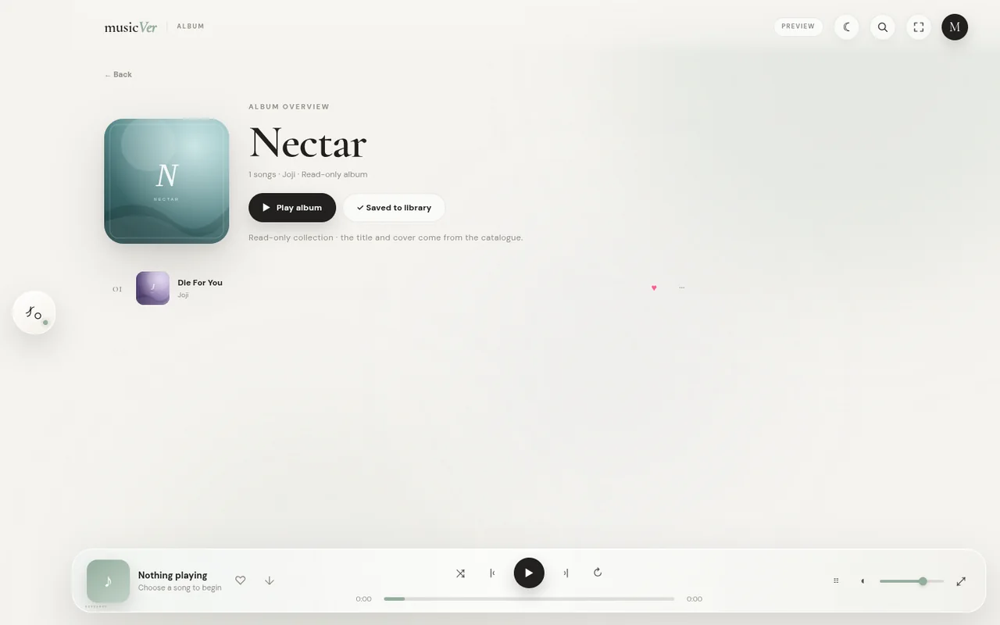</a><br><b>Album overview</b></td>
    <td align="center"><a href="docs/screenshots/06-library.webp">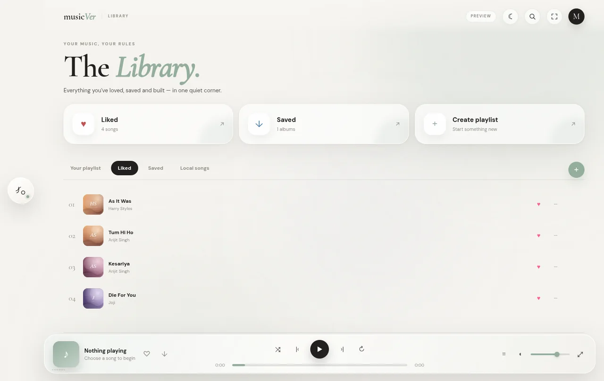</a><br><b>Library</b></td>
  </tr>
  <tr>
    <td align="center"><a href="docs/screenshots/07-account.webp">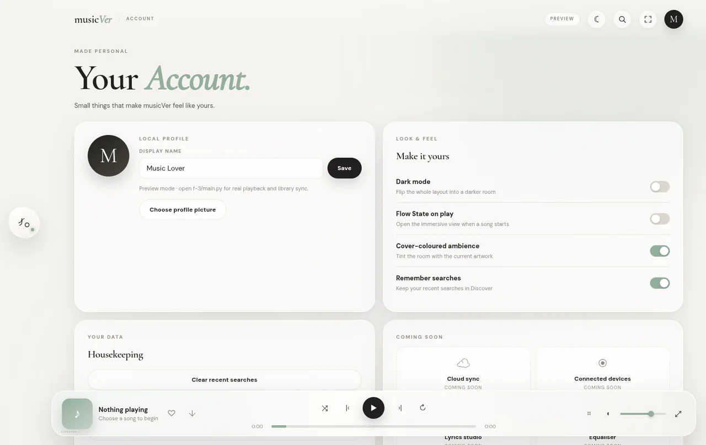</a><br><b>Account</b></td>
    <td align="center"><a href="docs/screenshots/10-island.webp">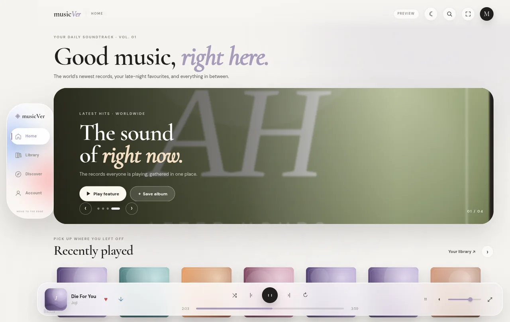</a><br><b>Dynamic island</b></td>
    <td align="center"><a href="docs/screenshots/11-queue.webp">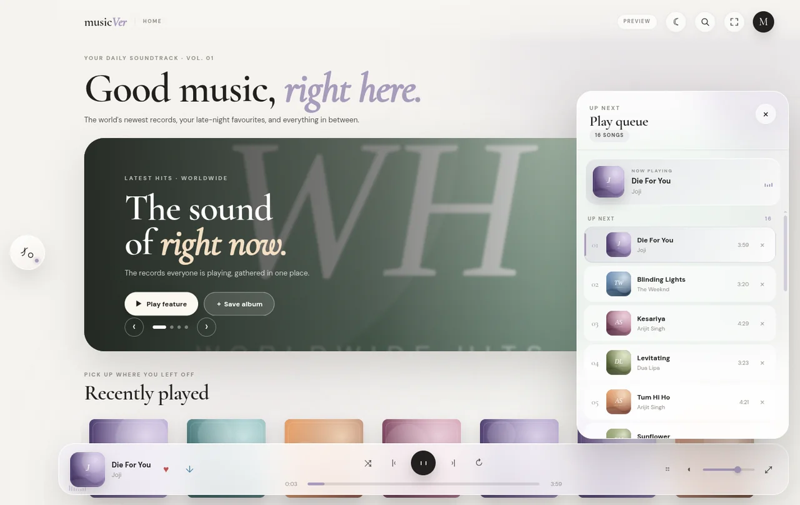</a><br><b>Queue drawer</b></td>
  </tr>
  <tr>
    <td align="center"><a href="docs/screenshots/08-flow.webp">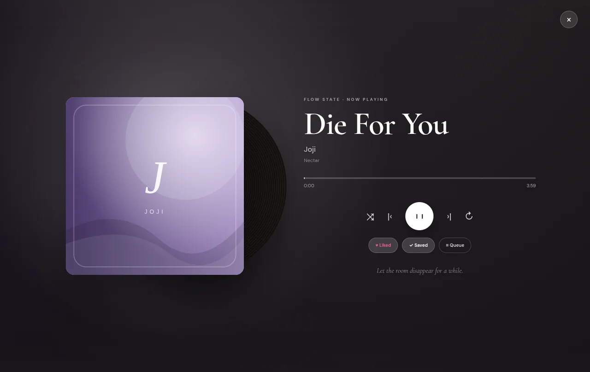</a><br><b>Flow State</b></td>
    <td align="center"><a href="docs/screenshots/09-dark-home.webp">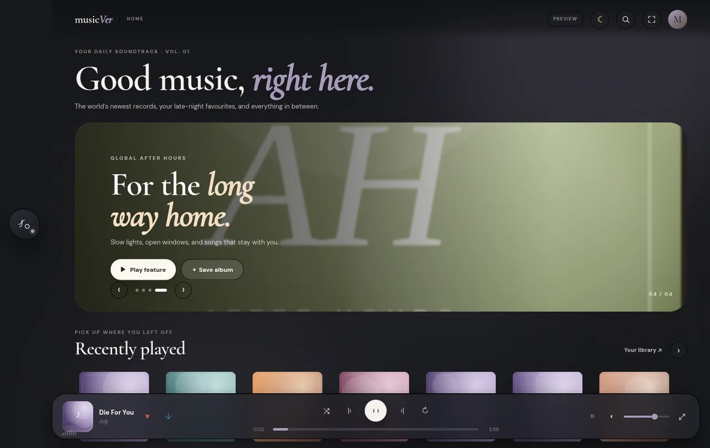</a><br><b>Dark mode</b></td>
    <td align="center"></td>
  </tr>
</table>

---

## Quick start

```bash
python -m venv .venv
source .venv/bin/activate
pip install -r requirements.txt
python main.py
```

On Windows use `.venv\Scripts\activate` instead of `source`.

The desktop window opens directly in **musicVer**. Playback uses VLC, settings
are stored locally, and the UI talks to the Python engine through pywebview's
`js_api` bridge.

The music folder defaults to `~/Music`. Change it from
**Dynamic island → Account → Music library → Choose folder** or from
**Library → Choose folder**.

---

## Launch options

`main.py` selects the interface from the `NEONWAVE_UI` environment variable.
If the variable is missing, musicVer (`f-3`) is used.

| Command | Interface |
| --- | --- |
| `python main.py` | **musicVer** (`f-3/index.html`) |
| `python f-3/main.py` | Standalone musicVer launcher |
| `NEONWAVE_UI=v2 python main.py` | Earlier `frontend_v2` interface |
| `NEONWAVE_UI=old python main.py` | Original `frontend` interface |

`v1`, `classic`, `legacy` and `frontend` are also accepted as aliases for the
original interface.

### Browser preview

`f-3/index.html` can be opened directly in a browser. This is useful for UI
work without starting pywebview or VLC. In preview mode:

- a curated local demo catalogue is used,
- playback progress is simulated,
- likes/playlists/theme still persist in `localStorage`,
- backend-only actions are safely skipped.

As soon as the page is loaded by pywebview, it detects
`window.pywebview.api` and uses the real Python backend instead.

---

## Features

### Dynamic island navigation

There is no traditional sidebar. A glass **musicVer** island floats at the top
left of the stage:

- move the pointer to the left edge, or click the pearl, to unfold it;
- choose **Home**, **Library**, **Discover** or **Account**;
- the active tab stays highlighted and the breadcrumb updates;
- the island closes automatically after navigation.

The island has a continuous liquid shape morph and separate blue/red glow
layers, so it feels alive without covering the music.

### Home

Home is designed to feel full without becoming a dense table:

- a cinematic hero slider rotates through featured songs and albums;
- **Recently played** reflects real playback history;
- **Trending now**, **Hindi songs** and **English songs** are horizontal,
  scrollable shelves of square cover cards;
- **Albums** uses the same shelf treatment;
- each shelf has a scroll arrow, and cards snap into place while scrolling;
- cards show the title and artist, with a play action on hover;
- the current cover colours the surrounding ambience and player chrome.

The layout was intentionally kept as Spotify-like shelves rather than a tight
multi-column grid.

### Discover and search

The Discover page has a centred search bar with soft blue and red corner
glows, recent searches and ordered results:

1. **Songs** — normal track rows with index, cover, title, artist, like, more
   and play controls.
2. **Artists** — bar/card rows instead of a plain text list. Each artist row
   includes the artist's top matched song so you can understand the match at a
   glance.
3. **Albums** — cover cards that open the read-only album overview.

For large catalogues, **Load more songs** appends only songs that have not
already been rendered. Duplicate IDs are skipped, and artist song pages use
the same de-duplication.

### Artist pages

Clicking an artist opens a full profile rather than starting playback:

- a compact banner with the artist portrait and short descriptive note;
- **Popular songs** with **Play all** and **Queue all**;
- a **Load more songs** button for paginated JioSaavn results;
- albums, singles, fans-also-like artists and featured playlists;
- every song/artist/album control keeps its normal like, save and play
  behaviour.

Artist data comes from the backend when live, with a local fallback for the
browser preview.

### Album overview

Opening an album never starts playback immediately. Instead you get an
immutable overview containing:

- cover art, title, artist, year and language from the catalogue;
- the complete track list as readable rows;
- a prominent **Play all** button at the top;
- a **Save** button that stores the album in Saved Albums.

The overview is read-only: the album title and cover cannot be edited from
this screen.

### Library and playlists

The Library page has three tabs:

- **Liked** — every song you have hearted;
- **Saved** — albums saved from album cards or the album overview;
- **Create playlist** — playlist management and the "Your playlist" grid.

Playlist features include:

- creating named playlists;
- adding and removing songs;
- choosing a custom playlist cover from your computer;
- resized covers stored locally through the backend;
- saving albums with the down-arrow control on album cards;
- scanning the configured local music folder into the library.

### Account and profile picture

Account is a local control centre:

- edit the local profile name and listening preferences;
- **upload a profile picture** from your computer;
- remove the current picture;
- choose or rescan the local music folder;
- run light housekeeping actions;
- see clearly marked *Coming soon* modules for future services.

The profile picture is resized to a compact data URL and saved in the backend
settings store, so it survives restarts. It is also mirrored into
`localStorage` for the browser preview.

### Player, queue and Flow State

The bottom player supports:

- play/pause with an optimistic UI so clicks feel immediate;
- previous/next with the legacy history-stack behaviour ported into musicVer;
- shuffle using the same history model as the old interface;
- repeat off / all / one;
- seek by dragging either progress bar;
- volume and mute;
- like, more options and add to queue;
- a glass **Queue** drawer with now-playing art, animated levels, track
  numbers, durations and a reliable close button;
- double-clicking the player, or using the expand button, to enter **Flow
  State**, a full-screen immersive now-playing view.

Playback state is snapshotted from the Python player (`current`, `queue`,
`index`, `playing`, `elapsed`, `duration`, `volume`, `shuffle`, `repeat`) and
mirrored into the SPA state. Startup guards prevent network streams from
auto-advancing while VLC is still buffering.

### Likes and saved albums

Likes use the restored legacy heart animation:

- the heart pops when toggled;
- small sparkles radiate from it;
- the effect appears on song rows, cards and the player.

Saved albums, liked songs, playlists and recently played entries are persisted
so the interface feels continuous across sessions.

### Dark mode and motion

Use the moon button in the header or the switch in Account to toggle themes.

- the choice is saved through `get_theme` / `set_theme`;
- the desktop window background is selected before the first paint;
- light and dark are connected by an 88-tile square-flip animation;
- in dark mode, white borders, insets and hairlines become dark;
- shelf cards intentionally remain borderless in both themes;
- the island glow, player ambience and queue glass adapt to the active theme.

### Audio sources

- **JioSaavn** — primary streaming source for search, charts, artists and
  albums; full audio URLs are resolved through the provider.
- **Local library** — scan a folder of your own audio files and play them
  directly.
- **Optional YouTube/VidKraken** — older video-host integrations remain
  available for compatible environments, but are not required by musicVer.

---

## How it is wired

```text
f-3/index.html
   │
   ├── MV.api.isLive() ── false ──▶ browser preview (local demo data)
   │
   └── true ──▶ window.pywebview.api ──▶ backend/api.py :: NeonWaveAPI
                                           ├── backend/player.py (VLC)
                                           ├── backend/settings_store.py
                                           ├── backend/saved_albums.py
                                           ├── backend/database.py (SQLite)
                                           └── JioSaavn / local providers
```

The frontend never imports Python. Every backend call is wrapped by
`f-3/js/api.js`, which normalises responses and provides safe preview
fallbacks.

---

## Project layout

```text
.
├── main.py                       default launcher + legacy UI overrides
├── backend/
│   ├── api.py                    pywebview API exposed to the SPA
│   ├── player.py                 VLC playback, streams and video surface
│   ├── database.py               SQLite schema and migrations
│   ├── settings_store.py         theme, profile picture, music folder
│   ├── saved_albums.py           saved-album persistence
│   └── services/                 JioSaavn, YouTube, download and media helpers
├── f-3/                          the musicVer SPA (default interface)
│   ├── index.html                all pages, player and overlays
│   ├── css/
│   │   ├── base.css              theme tokens, dark overrides, shared surfaces
│   │   ├── layout.css            island, pages, hero, account, flow, modals
│   │   └── components.css        cards, song rows, search, player, queue
│   ├── js/
│   │   ├── data.js               demo catalogue and normalisers
│   │   ├── store.js              likes, albums, playlists, history
│   │   ├── api.js                pywebview bridge + preview fallback
│   │   ├── player.js             playback state, queue, shuffle, cover colours
│   │   ├── ui.js                 rendering and interactions
│   │   └── app.js                bootstrap
│   └── main.py                   standalone launcher
├── docs/screenshots/             images used in this README
├── frontend/                     original interface (preserved)
├── frontend_v2/                  earlier interface (preserved)
└── requirements.txt              Python dependencies
```

---

## Data and privacy notes

- `data/neonwave.db` and `data/app_settings.json` are generated locally and
  are intentionally not committed.
- Streaming uses JioSaavn's public, unofficial API and requires an internet
  connection.
- Music remains the property of its respective rights holders. Use it for
  personal listening.
- YouTube support, when enabled, uses the official IFrame API and requires
  `YOUTUBE_API_KEY` in `.env`.
- VidKraken features are optional and require `VIDKRAKEN_API_KEY`.
- Profile pictures and playlist covers are stored locally, resized, and never
  uploaded by this app.

---

## Troubleshooting

**The window opens with no audio.**
Make sure VLC is installed and that `python-vlc` can find it. Check the
pywebview debug console for stream errors.

**Playback takes a moment to start.**
JioSaavn serves AAC inside an MP4 container. NeonWave forces VLC's FFmpeg
demuxer and uses a shorter network cache for these streams, which avoids the
end-of-file seek that caused long silent pauses. You can compare VLC, the
optimised VLC path and ffplay yourself:

```bash
python tools/playback_startup_probe.py --query "Kesariya" --runs 3
```

The probe prints HTTP time-to-first-byte and time-to-first-audio for each
player. Use `--aout pulse` to test the real desktop audio output; the default
is silent.

**Search does not return live results.**
JioSaavn access needs an internet connection and the unofficial API may
change. The browser preview will still show the bundled demo catalogue.

**Theme or profile picture resets.**
Run the app through `python main.py` so the Python settings store is available.
In pure browser preview these values live only in `localStorage`.

**I want the old interface.**
Use `NEONWAVE_UI=v2 python main.py` or
`NEONWAVE_UI=old python main.py`. Nothing in the older frontends was removed.
